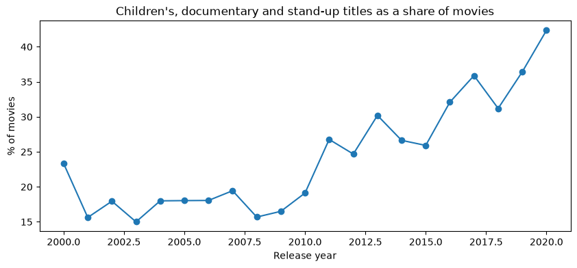

# Investigating Netflix movie durations

> This analysis has been merged into [Are-Netflix-Movies-Getting-Shorter](https://github.com/Sammyjoseph999/Are-Netflix-Movies-Getting-Shorter), which is the maintained version. This repository is archived.

An exploratory look at how the length of Netflix movies varies by genre and release year.



## Data

`netflix_data.csv`: about 7,800 Netflix titles. The data comes from the DataCamp project of the same name.

## Key results

- The median movie runs 98 minutes; stand-up specials (65), children's titles (86) and documentaries (87) are the shortest genres.
- Those three genres are under 20% of movies released in the 2000s and 42% of 2020 releases.
- A falling average duration therefore says as much about what is on the platform as about films getting shorter.

## Running the notebook

```bash
pip install -r requirements.txt
jupyter notebook notebook.ipynb
```
